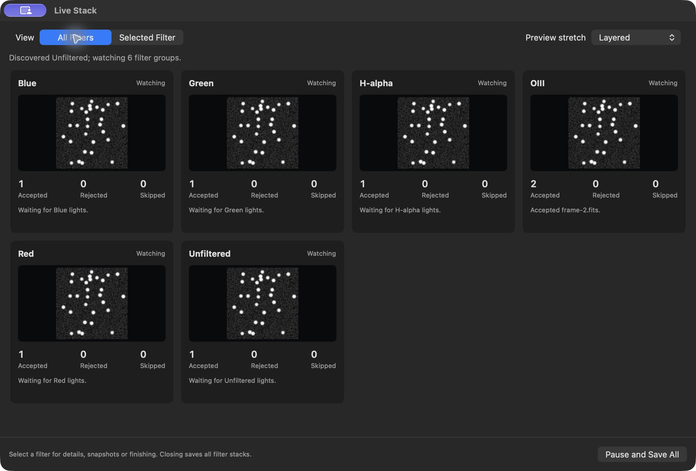
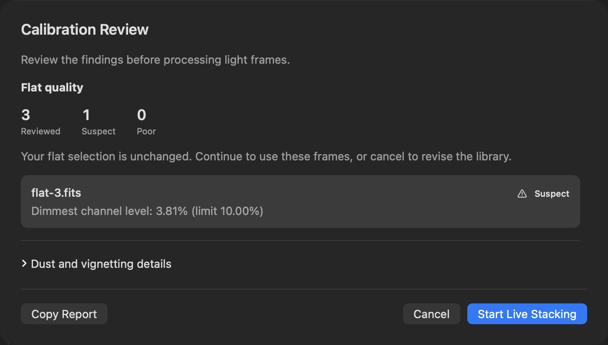
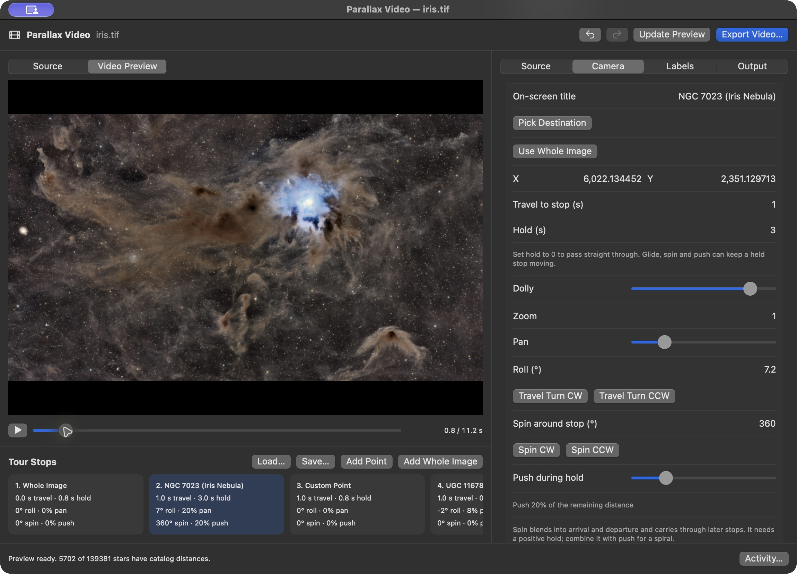
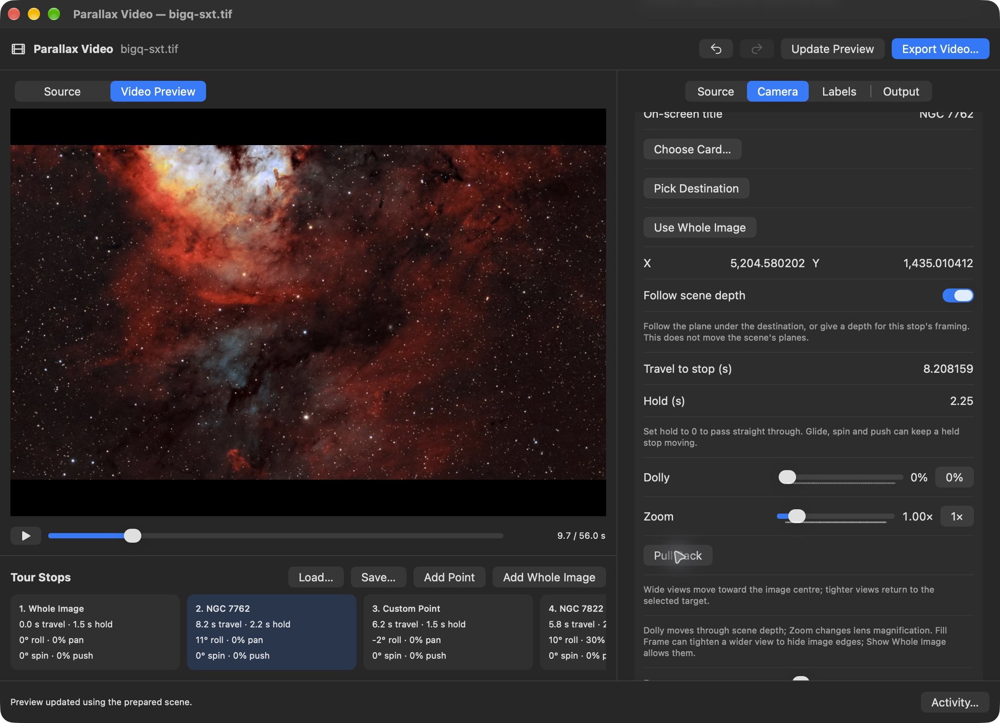
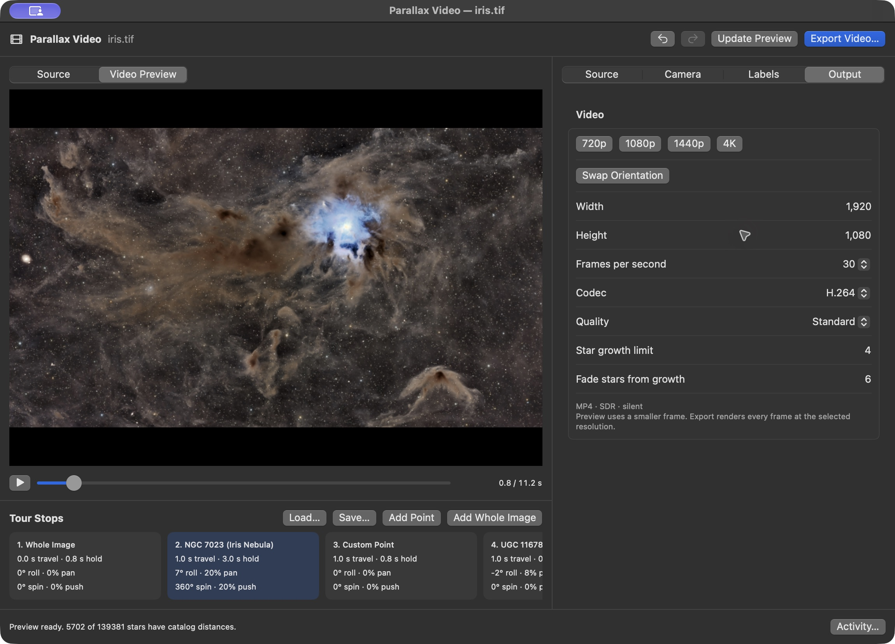
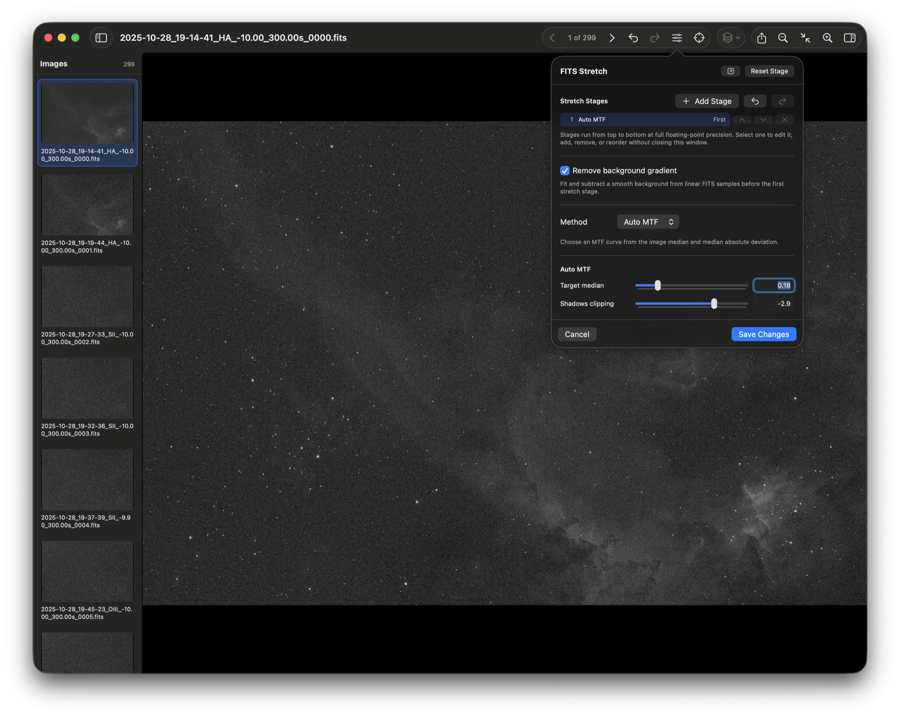
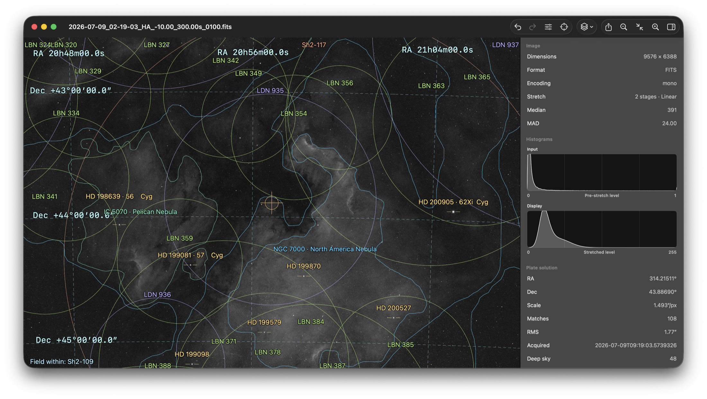
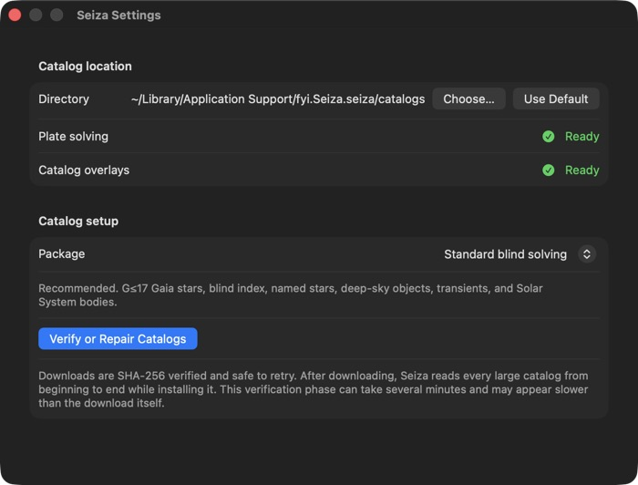

# Seiza for Mac

**A native Mac workspace for astronomy images, stacking, and parallax video.**

Open one image or a whole night of captures. Step through them instantly. Stretch
FITS or XISF data, inspect headers, plate-solve a frame, and see the stars and deep-sky
objects in it. Turn a finished image into a camera tour with depth, motion, and
titles. Image processing and video encoding run locally; optional online
stellar-distance lookup sends sky coordinates to astronomical catalogues.

[**Download Seiza for Mac 0.8.7**](https://github.com/theatrus/seiza-mac/releases/latest/download/Seiza-0.8.7-universal.dmg) · [Release notes and other downloads](https://github.com/theatrus/seiza-mac/releases/latest)

**Also from Seiza:** [Core, CLI, and libraries](https://github.com/theatrus/seiza) ·
[Seiza for Windows](https://github.com/theatrus/seiza-win) ·
[FITS and XISF for Photoshop](https://github.com/theatrus/xisf-photoshop)

## New in 0.8.7

- Watch every in-progress filter together in **All Filters**, or inspect one
  filter's full preview, depth chart and export controls.
- Discover filters in nested capture folders, with independent calibration,
  resumable stacks and completion records. Pause all or finish one filter.
- Use **Median Anchor** and **Layered** stretches in image recipes and live
  previews; display changes preserve the linear stack.
- Review flat quality before stacking, with compact findings, expandable dust
  details and a complete copied report.
- Remember the RC-Astro executable across Parallax windows and app launches.





## Features

- **[Parallax videos and tours](#parallax-videos-and-tours)** — Turn an astrophoto into a fly-in or editable camera tour, then export H.264 or HEVC video.
- **[Image viewing and folder review](#image-viewing-and-folder-review)** — Open FITS, XISF, and raster images; browse a whole night with cached thumbnails and fast previews.
- **[Stretch and image processing](#stretch-and-image-processing)** — Build live stretch recipes, correct backgrounds, and apply light deconvolution.
- **[Directory and live stacking](#directory-and-live-stacking)** — Align and combine selected frames or watch a capture folder, with calibration, rejection, and resumable sessions.
- **[Plate solving and sky overlays](#plate-solving-and-sky-overlays)** — Solve locally, identify stars and deep-sky objects, and export WCS solutions.
- **[Star and tilt measurement](#star-and-tilt-measurement)** — Measure stellar quality, sensor tilt, and field curvature directly from a linear image.
- **[Catalogs and distance data](#catalogs-and-distance-data)** — Download and verify solver catalogs and offline parallax distances from Settings.
- **[Image export and Finder integration](#image-export-and-finder-integration)** — Save full-size images with overlays and preview FITS/XISF files in Finder.

## Parallax videos and tours

Turn a finished image into a **parallax video**: nearby stars move past distant
ones as the camera travels toward a nebula or across the field. Seiza combines
your starless and stars layers with catalog distances to give the scene depth.
Generate a tour of the objects in your image, or choose the stops yourself.

Watch examples made with Seiza's parallax engine. Click either preview to play
the video in your browser:

| [Watch the seiza.fyi demo](https://seiza.fyi/media/parallax-tour.mp4) | [Watch the Iris Nebula tour](https://theatr.us/gallery/_video/astrobin/iris-nebula/288w86) |
| --- | --- |
| [](https://seiza.fyi/media/parallax-tour.mp4) | [](https://theatr.us/gallery/_video/astrobin/iris-nebula/288w86) |

Examples from [seiza.fyi](https://seiza.fyi/#parallax-video) and
[Yann Ramin's Iris Nebula gallery on theatr.us](https://theatr.us/gallery/astrobin/iris-nebula).
Browse more astrophotography in the [Astrobin gallery](https://theatr.us/gallery/astrobin).

### Edit the journey in a native Mac workspace

Choose **File → Parallax Video…** to open the video workspace. Each stop has its
own destination, travel time, hold, zoom, pan, roll, spin, and forward push.
Add fading titles, keep the camera gliding through holds, and make the tour loop.
Scrub the preview while you edit; camera changes reuse the prepared scene.
After **Prepare Preview**, generated tours use the scene's depth planes and
distance overrides. Each stop can follow the scene's depth or use an explicit
distance, which is preserved when saving and loading tours.



Export a silent MP4 in **H.264 or HEVC** with the Mac's native video encoder.
Choose 720p through 4K presets, portrait or landscape, or custom dimensions.
Use **Show Whole Image** to retain the complete photograph with black space
beside it, or **Match image shape** for a square or tall video without cropping
its edges. Draw a crop in Source when you want to film a particular region.
Save and load tour itineraries as JSON to revisit the route later.

In **Source → Stars and dust**, choose a dust map painted white where dust is
opaque. Export the current map, edit it in an image editor, and reload it without
preparing the scene again. Reset returns to dust estimated from the stars.

Turn on **Source → Depth planes** to move catalogued nebulae at distances of
their own, and dust clouds in front of the nebula, on planes of their own. Dark
nebulae move with the dust they lie in. The section lists the planes found, and
a plane named after a catalogued object takes a distance of your own.
**Object distances** also accepts other catalogue names, including large objects
left on the background. **Custom depth planes** imports painted masks with
names and distances, with controls to replace, reload or remove each mask.

### Make a parallax tour

1. **Open your finished image** and choose **File → Parallax Video…** or the
   film toolbar button. In **Source**, import matching, stretched starless and
   unscreened stars PNG/TIFF layers. Matching alignment is enabled by default. An installed,
   licensed StarXTerminator CLI is also supported.
2. **Give the scene depth.** Download solving catalogues and **Offline parallax**
   data in Settings. The Source inspector also offers the offline distance
   download. Online distance lookup is optional; fields without background
   distance data can use a manual distance.
3. **Plan the camera move.** Click **Prepare Preview** to build the scene, then
   choose Fly In or generate a tour in **Camera** using that scene's depths.
   Review the candidate, click **Apply Tour**, then edit the stops, motion, titles,
   and looping. Camera edits update the preview without repeating star detection
   or distance lookup.
4. **Export the video.** Add annotations, a credit and logo, and title cards in
   **Labels**. In **Output**,
   choose dimensions, frame rate, H.264 or HEVC, and quality, then click
   **Export Video…**. Rendering and encoding run locally.

Pull back a target or custom point with its **Dolly** slider, and use **Zoom**
for finer framing. Pull-back moves toward the whole image while preserving the
opening shot and other stops. Aligned stars supply the solve for a starless
source; the Source inspector makes the solving choice explicit.





Use **Save…** and **Load…** in the Tour Stops strip to exchange JSON itineraries.
An itinerary saves the route, crop, and tour motion options; it does not include source
images, overall zoom, scene settings, labels, or export preferences. Full
video-project recovery remains planned. See the
[implementation scope and remaining work](docs/PARALLAX-VIDEO.md).

## Image viewing and folder review

Open a FITS, XISF, JPEG, PNG, or TIFF image, or a directory of mixed formats.
Directory browsing includes nested subfolders, with collapsible groups by
folder path, file type, or filename filter. Repeated filenames show their
parent paths, and unreadable locations have details in the browser.
Drop a new file onto a viewer to replace its image. Move through hundreds of
frames with the arrow keys and thumbnail drawer; local caching and nearby-image
preloading keep review responsive, including on network folders.

Seiza renders mono, planar RGB, and Bayer/OSC data through the full-precision
core. A quick, zoom-aware preview appears first, followed by a source-resolution
render. Filtered reductions limit aliasing while source pixels stay crisp at
1:1 and higher zoom. Fit, zoom, and pan around the pointer, inspect the input
and display histograms, and search or copy image headers.



[Read the practical guide to browsing and inspecting images.](docs/USING-SEIZA.md#open-one-image-or-a-directory)

## Stretch and image processing

Add, remove, reorder, and edit automatic or manual stretch stages while viewing
the result. Pick GHS symmetry points from the image, choose linked,
per-channel, or luminance-preserving color, copy adjustments between images,
and undo or redo each change. Stretch controls can detach into a persistent
panel while you browse a directory.

Correct backgrounds with automatic, polynomial, or radial-basis gradient models
on linear mono or color data. Choose additive subtraction or multiplicative
illumination correction and inspect changes through the live preview. Optional
damped Richardson–Lucy deconvolution provides controls for stellar FWHM,
strength, noise, and ringing.

[Learn how to build a processing recipe.](docs/USING-SEIZA.md#build-an-astronomy-stretch)

## Directory and live stacking

### Stack selected frames

Combine selected FITS or XISF lights into 32-bit floating-point FITS outputs,
with optional grouping by filename filter. Choose a channel reference for each group
or let Seiza rank candidates and retry alignment. An optional **Shared alignment
image** puts every filter on the same output grid while preserving each
channel’s own normalization. Calibrate with existing masters or build and
cache matched masters from raw calibration frames. Track progress and SNR,
cancel a run, and open the saved results.

### Select and stack mosaic panels

Turn on **Group mosaic panels by solved coordinates** in the Stack dialog,
solve selected lights, then select whole panels or individual exposures.
Disconnected fields and filters produce separate outputs. Choose **Expanded
mosaic** to retain panel edges, with a memory ceiling and native planning/lens
notes. See the [mosaic and GPU guide](docs/MOSAIC-STACKING.md).

In **Settings → Stacking performance**, **Use GPU for stacking** defaults to
automatic GPU use with CPU fallback. Turning it off keeps new stacks on the CPU;
active and resumed live stacks retain their saved mode.

### Stack as exposures arrive

Watch a capture folder during an imaging session. Seiza waits until each FITS
or XISF file stops changing, checks that it is a raw, compatible light, and
registers it into a stack locked to that filter. The live window shows an
autostretched preview, accepted and rejected counts, calibration epochs,
checkpoint health, and an SNR depth chart.

Save a non-destructive FITS snapshot at any time or finish the accumulator into
a final 32-bit floating-point stack. Sessions checkpoint the exact native state:
pause, close, or recover after a crash and resume the same accumulator. A
previous complete generation remains available after an interrupted write.

### Tune alignment and integration

Directory and live stacking share controls for:

- Similarity, affine, or quadratic registration, with error, drift, and overlap limits.
- Global, local, or local-background normalization, or no normalization.
- Delta-sigma sample rejection, or no rejection, and three-pass transient removal for trails left by the live pass.
- Equal or bounded inverse-noise-variance frame weights.
- Bilinear or Lanczos-3 interpolation.
- VNG, MHC, or bilinear demosaicing; Bayer drizzle; and optional hot/dead pixel suppression.

Advanced modes are opt-in; core defaults stay unchanged. Transient removal runs
by default when finishing a stack.

[Stack a directory](docs/USING-SEIZA.md#stack-a-directory) or
[set up live folder stacking](docs/USING-SEIZA.md#stack-a-folder-live). See the
[shared-reference guide](docs/STACKING.md) for alignment-image selection and
checkpoint behavior.

## Plate solving and sky overlays

Press Solve when you want sky context. Seiza draws catalog-colored object
outlines, names, stars, and a WCS grid over the image, while the inspector keeps
the input and display histograms and solve quality visible.



Plate solving runs locally when you press **Solve** or request a video operation
that needs sky coordinates. It sends no image or catalog data off the Mac.
Choose overlays for named and field stars, deep-sky catalogs, OpenNGC outlines,
transients, comets, asteroids, detections, the coordinate grid, and field center.
Export a solved image's linear or SIP solution as a standard header-only FITS
`.wcs` sidecar.

[Explore the solving and overlay controls.](docs/USING-SEIZA.md#solve-only-when-you-ask)

## Star and tilt measurement

Measure stars directly from a linear image without a solve or catalog. Seiza
reports HFR, FWHM, SNR, background, and PSF eccentricity per star, with a 3-by-3
sensor grid, corner tilt and field-curvature verdicts, and a triangle sector
analysis. Verdicts are withheld until every required region contains at least
three stars.

Show measured stars and the tilt grid in the viewport or composited exports.
Optional parallelogram and triangle tilt diagrams start off. These measurements
help compare captures before deciding which frames to stack.

[Read the star and sensor-tilt guide.](docs/USING-SEIZA.md#measure-stars-and-sensor-tilt)

## Catalogs and distance data

Previewing images does not require catalog data. Solving starts when you press
Solve, or when preparing a video or generating a tour without sky coordinates.
Blind solving any supported FITS, XISF, or raster image requires
a complete Seiza catalog directory containing a star catalog and blind index.

Open **Seiza > Settings** (`Command-,`), leave **Standard blind solving**
selected, and click **Download and Install Catalogs**. You can use Seiza's
default data location or choose another writable directory. The Settings pane
reports download, installation, and verification progress and may be closed
while setup continues.



Downloads are SHA-256 verified into Seiza's immutable cache. Setup then hard
links those verified files into the selected catalog directory when possible,
avoiding the previous second copy and full hash pass. Cross-filesystem installs
fall back to a verified copy. Setup is safe to retry and reuses cached data.

The equivalent command-line setup is:

```sh
seiza setup
```

or:

```sh
seiza download-data prebuilt --output /path/to/catalogs
```

If you created a catalog directory on the command line, choose that directory
in Seiza's Settings. The sandbox permission is retained as a security-scoped
bookmark. The main object catalog supplies named-star and deep-sky overlays,
`transients.bin` supplies dated transient overlays, and `minor-bodies.bin`
supplies comet and asteroid positions at the image acquisition time. Solving and
catalogue loading begin only when requested by Solve or a video operation. If
the required star catalog or blind index is missing, Solve explains the problem
and links back to Catalog Settings.
Satellite overlays are not yet available.

For parallax video, Settings also offers **Offline parallax**. The same
download is available in the video's Source inspector and installs stellar
distances, object distances and the object catalogue. Solving catalogues are a
separate package. Online distance lookup is optional and off by default.

## Image export and Finder integration

Export full-size PNG, JPEG, or TIFF files, with optional sky or measurement
overlays. PNG and TIFF support 16 bits per channel. Full-size clipboard copy
also keeps visible overlays.

Seiza registers `.fits`, `.fit`, `.fts`, and `.xisf` files with a document icon
and two Quick Look extensions. Finder shows stretched thumbnails in icon,
list, column, and Gallery views. Select a file and press Space for a larger
preview without opening Seiza. Quick Look preserves the image's aspect ratio
and refits the whole frame as its window changes size.

[Export images](docs/USING-SEIZA.md#export-the-result) or
[use Finder Quick Look](docs/USING-SEIZA.md#finder-quick-look).

## Download

[**Download Seiza for Mac 0.8.7**](https://github.com/theatrus/seiza-mac/releases/latest/download/Seiza-0.8.7-universal.dmg), open it, and drag Seiza to Applications.

Or install with [Homebrew](https://brew.sh) from the
[theatrus/homebrew-seiza tap](https://github.com/theatrus/homebrew-seiza):

```sh
brew install --cask theatrus/seiza/seiza-mac
```

Seiza requires macOS 15 or newer. The same download runs natively on Apple
silicon and Intel Macs. Release builds are signed with Developer ID and
notarized by Apple.

Signed in-app updates use Sparkle to verify and install releases. Check on
demand or enable a schedule you control.

## Open FITS and XISF in Photoshop

The separate [FITS and XISF Photoshop plugins](https://github.com/theatrus/xisf-photoshop)
let you open and save astronomy images directly in Photoshop using Seiza's codecs.
Import as Float32 or rescaled 16-bit integer, optionally debayer Bayer mosaics to
RGB, and save at the document's 16- or 32-bit depth by default.

Download the **universal macOS plugin DMG** from the
[latest release](https://github.com/theatrus/xisf-photoshop/releases/latest).
Close Photoshop, open the DMG, and drag both `.plugin` bundles onto the
**Photoshop Plug-ins** shortcut. Approve any administrator prompt, eject the
DMG, and restart Photoshop. The shortcut targets Adobe's shared folder at
`/Library/Application Support/Adobe/Plug-Ins/CC`. Remove older copies from
Photoshop application or custom folders when switching to this location.
If the shared folder is missing, see the
[installation guide](https://github.com/theatrus/xisf-photoshop#macos-installation-dmg).
A ZIP remains available as an alternative. The DMG and bundles support Apple
silicon and Intel and are Developer ID signed, notarized, and stapled.
Configure import defaults under
**Photoshop → About Plug-In → FITS/XISF**.

Starting with plugin 0.5.0, same-format saves retain source headers and metadata;
switching formats copies compatible FITS keywords on a best-effort basis.
Keep your original FITS/XISF files: 16-bit import rescales the image and loses
absolute scale and precision. Re-solve astrometry after geometric edits, and use
PSD/PSB to retain Photoshop layers. See the
[metadata retention limits](https://github.com/theatrus/xisf-photoshop#metadata-retention).

## Development

Seiza is built with SwiftUI, AppKit, and the
[Seiza](https://github.com/theatrus/seiza) Rust core. Image processing and video
encoding run natively on the Mac.

### Build

Requirements: macOS 15 or newer, Xcode 26 or newer, Rust 1.99.1, and the Rust
target matching the Mac being built.

```sh
cargo test --workspace
xcodebuild \
  -project Seiza.xcodeproj \
  -scheme Seiza \
  -configuration Debug \
  -derivedDataPath DerivedData \
  CODE_SIGNING_ALLOWED=NO \
  build
```

The unsigned development app is written to:

```text
DerivedData/Build/Products/Debug/Seiza.app
```

Open `Seiza.xcodeproj` to run and sign it with a local development team.

The app uses published `seiza-cabi` 0.44.2, `seiza` 0.44.2,
`seiza-parallax` 0.19.2, `seiza-stacking` 0.51.2 and `seiza-download` 0.9.0, with dust maps, depth planes and
image reading and writing through `seiza-image-io`. Library and bridge header
must be updated together. About reports the linked release version and source
commit. Optional [flat-quality review](docs/CALIBRATION-QUALITY.md) uses the native
dust diagnostics during automatic calibration.

**File → Color Tools…** opens preview-first narrowband, continuum subtraction,
and RGB star extraction/restoration workflows. See [Color Tools](docs/COLOR-TOOLS.md)
for linear/display declarations, stellar fit review, and exact-source plans.

### App icons

The app and astronomy document icons are generated from the checked-in colorful
Seiza website mark. Regenerate them on macOS with:

```sh
swift scripts/generate-app-icons.swift
swift scripts/generate-document-icon.swift
```

### Tests and continuous integration

[](https://github.com/theatrus/seiza-mac/actions/workflows/ci.yml)

The repository exercises the Rust rendering/C ABI with unit tests and the
native application with XCTest. Every pull request checks Rust formatting and
Clippy warnings, runs both test suites, validates all app and extension property
lists, builds a universal Release application, and verifies an unsigned
development DMG. Pull-request jobs have read-only repository access and never
receive signing secrets.

A push to the official `main` branch runs the same unsigned checks. Only final
release tags enter the protected signing environment and produce signed,
notarized downloads through GitHub Releases.

```sh
cargo test --workspace --locked
xcodebuild test \
  -project Seiza.xcodeproj \
  -scheme Seiza \
  -destination 'platform=macOS' \
  -derivedDataPath DerivedData \
  CODE_SIGNING_ALLOWED=NO
```

Tags matching `vMAJOR.MINOR.PATCH` enter the protected `signing` environment,
Developer ID sign and notarize the app and DMG, sign the update ZIP, and
publish the appcast, universal DMG, and zipped app to GitHub Releases. See
[RELEASE.md](RELEASE.md) for the complete release runbook and
[docs/RELEASING.md](docs/RELEASING.md) for credential and environment setup.

See the [usage guide](docs/USING-SEIZA.md),
[architecture](docs/ARCHITECTURE.md), and [roadmap](docs/ROADMAP.md).
