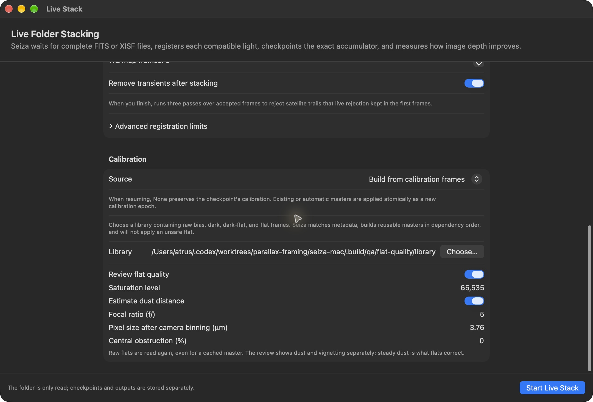
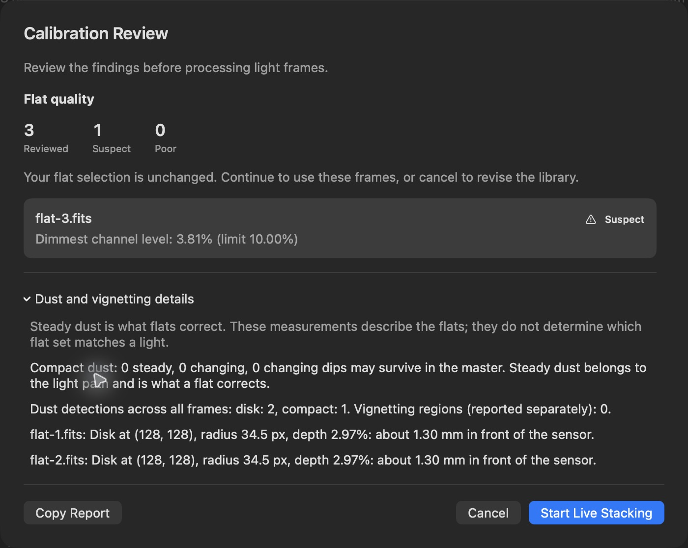

# Calibration quality

This branch targets core/C ABI 0.47.0, calibration 0.11.0, stacking 0.54.0,
stretch 0.3.2 and parallax 0.19.5. Cargo pins the shared file coordinator
commit from [Seiza #406](https://github.com/theatrus/seiza/pull/406); the complete generated C header matches it. Graded library
setup calls the shared C ABI described in the [setup guide](STACKING-CALIBRATION.md).

## Inspect one flat in the sidebar

Open a flat image, show the right-hand Inspector and click **Inspect Flat**.
The source file is measured off the main thread with the existing native flat
measurement and screening calls. The sidebar includes raw levels, clipping,
noise, dust geometry, vignetting and an illumination map. Saturation and optional
optical geometry are adjustable. It shows the default single-frame grade for raw
flats, but no raw-exposure grade for processed or master flats. It does not infer
session stability or light matching from one frame. Changing viewer adjustments
does not alter the measurement input. See [the inspection guide](USING-SEIZA.md#inspect-a-flat).

For a mixed folder, **Stack Images** routes calibration frames to the shared
graded coordinator automatically. Review the group's grades and matches there;
its matching settings and selection remain native.

## Review selected flats during live preparation

In **Live Stack**, choose **Build from calibration frames**
and enable **Review flat quality**. Seiza measures the exact raw flat set
selected by native metadata matching, including when its master is cached.
The review appears before light frames are processed. It does not exclude,
reorder or replace frames. Cancel to revise the library, or continue with the
same selection. The feature is opt-in and does not change cache identities.

Set **Saturation level** to the raw sample value at saturation: usually 65535
for 16-bit ADU or 1 for normalized samples. Match the actual file units; the
app does not guess a saturation value from a flat's measured brightness.

The review opens with reviewed/suspect/poor counts and individual frame issues.
Preparation warnings and the combined-master verdict remain separate. **Dust and
vignetting details** expands the measurements; **Copy Report** includes every
reported detail, including collapsed sections. For large sets, the first ten
flagged frames appear initially, with an action to show the rest.

The native screen reports clipping, channel exposure, illumination differences,
compact dips and changing defects that a master may retain. Steady dust is what
flats correct; finding a dust disk alone is not grounds to reject a flat. The
report lists disk, donut, patch, compact and irregular detections across frames,
with vignetting counted separately. Counts across frames are not unique physical
particles. Per-frame findings retain their native measured value and limit.

**Estimate dust distance** optionally accepts focal ratio, pixel size after
camera binning, and obstruction diameter as a percentage of the aperture.
For a 3.76 µm sensor recorded with 2×2 camera binning, enter 7.52 µm. Internal
analysis downsampling and CFA sums are handled by the core. Geometry is sent
only when enabled, and focal ratio and pixel size are required together. Disk
and donut distances are estimates from the supplied light cone, not a physical
identification of the dirty surface. The review lists up to eight of the deepest
located detections with their frame, coordinates, radius and depth.

Measurements and screening run off the main thread, one raw frame at a time.
The current ABI has no cancellation argument for these calls; cancellation is
checked between calls and before publishing the report. A failed measurement
produces an explicit incomplete-review notice, never a passing verdict on a
partial subset. Measurements are not persisted; an older algorithm's stored
results cannot be mistaken for new ones. File identities are checked around
the review. Existing preparation gates still require compatible metadata and a
safe bias/dark pedestal before a flat can be used.

## Coverage audit

| Capability | Mac status | Next step |
| --- | --- | --- |
| 0.34 flat measurement shapes, radii, holes, distances and vignetting | Carried through the Swift bridge and used by the optional review | Structured frame issues and expandable dust details are available; an image overlay remains a possible addition |
| Native flat-set screening | Used on the selected raw set; frame/master findings shown before stacking | Consider explicit user-driven exclusion/re-screening rather than automatic removal |
| Session-stack dust and cross-session dust matching (`dust::find_session_dust`, `find_changes`, `match_features`) | Available through the published C ABI; no Mac session-comparison UI yet | Build a session-comparison workflow with explicit insufficient-evidence states |
| Flat-response construction/comparison and measured selection (`flat_response::metric`) | Available through the published C ABI; no Mac response-selection UI yet | Keep metadata/pedestal gates; add an explicit measured-response selection workflow |
| Bias/dark quality measurement and screening | C ABI available; Mac automatic preparation still uses metadata and build validation | Extend the optional review with native bias/dark verdicts |
| Residual flat response construction/validation/application | C ABI available, no Mac editing/application workflow | Design explicit preview and application to avoid double correction |
| RGB/LRGB/narrowband composition and photometric color calibration | C ABI available, no Mac composition controls | A separate channel-composition workflow can reuse the existing per-filter stacks |
| Satellite catalogs and predicted tracks | C ABI available, no Mac track overlay | Add an observation-time-aware overlay and catalog source controls |

The existing aggregate optics matcher already covers rotation checks; an unused
lower-level rotation export is not by itself a missing product feature. The new
flat diagnostics also do not establish which flat session a particular light
follows. That needs the response/selection APIs above.

These calibration dust diagnostics concern shadows on a sensor or optical
train. Parallax's painted sky-dust maps remain a separate feature and retain
the source-space coordinate contract adopted in 0.33.

## Validation

Native tests exercise a real FITS dust disk, native algorithm-version reporting,
physical geometry, lossless measurement re-encoding, screening, invalid options
and mismatched frame sizes. Automatic preparation tests repeat review against
cached masters and assert unchanged output/cache identity and a compact live
summary. Optimized UI smoke testing used three synthetic flats, including one
underexposed frame: the review flagged that frame at 3.81% of full scale,
reported two disks at about 1.30 mm, and returned to configuration on Cancel.

## Published session and processing APIs

The 0.35 session/response bindings are included in 0.39: flat-response
construction/comparison, change maps, light-background fitting, candidate
selection, session dust extraction and matching, and constellation projection.
A fit can return `no_shadows` or `unfitted`; these are inconclusive evidence,
not a passing review. This update does not silently start using these APIs to
replace flats. The existing frame review retains original selection and units.

The Windows #66 parity work adds Median Anchor/Layered controls and independent
multi-filter live sessions; persistent RC-Astro settings have reached main.
See [DESKTOP-PARITY.md](DESKTOP-PARITY.md) for scope and merge order.
Core 0.39 also exports stacking/stretch output versions, automatic sensor-defect
learning, and one-step Gaia colour calibration plus stretch. Existing Mac
master/thumbnail cache identities include the full core release, conservatively
invalidating them when any native processing changes. Native checkpoint readers
remain responsible for context compatibility; old contexts must never be
silently treated as compatible.
