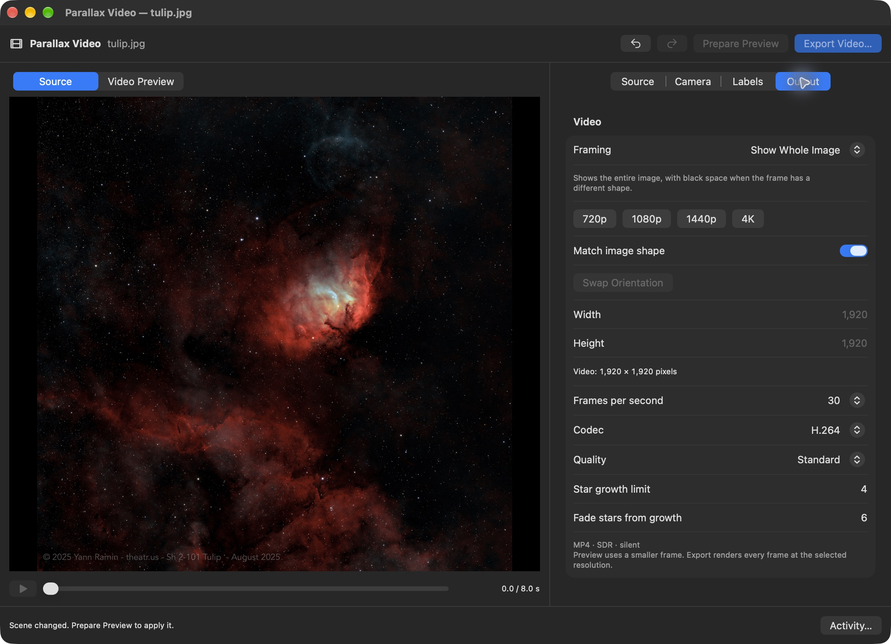
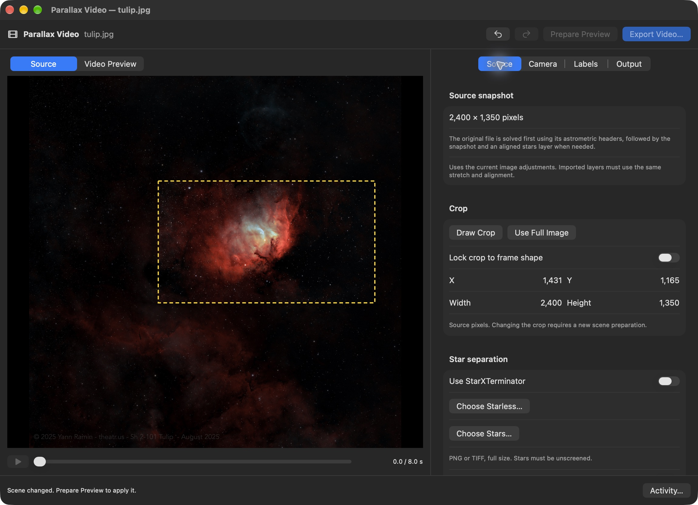
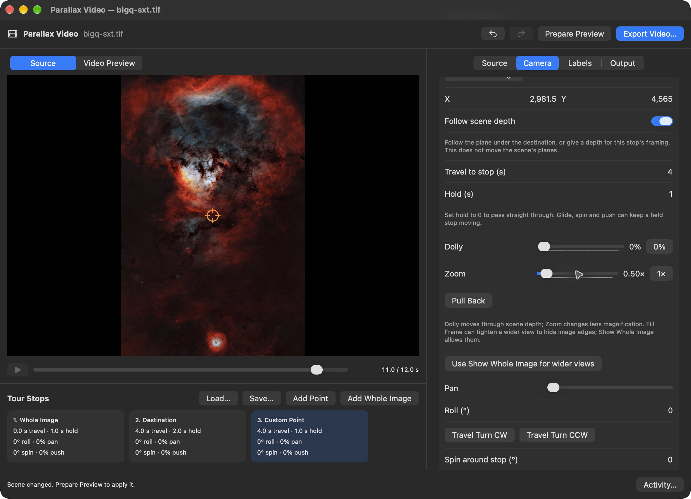

# Parallax video for Mac

Seiza for Mac **0.8.0** uses published `seiza-cabi`
**0.25.1**, `seiza` **0.25.1**, and `seiza-download` **0.8.0**, following the merge
of [seiza PR #240](https://github.com/theatrus/seiza/pull/240). The complete bridge
header matches the C ABI crate. Cargo locks the registry checksums and builds
use `--locked`; the release commit is `9f17e90f84e6841e69f8f8e39e6bd9b7e1b47c00`.

Published `seiza-parallax` **0.2.1** includes the loop and halo fixes from
[PR #242](https://github.com/theatrus/seiza/pull/242). Its renderer sources match
the previously tested patch byte-for-byte. The local vendor copy, Cargo patch
and temporary About metadata have been removed; all Seiza crates now resolve
from crates.io with registry checksums.

## Published dependency update

Seiza for Mac **0.8.1** uses published core/C ABI **0.27.0**, stacking **0.29.0**,
and parallax **0.4.0**, with the matching C ABI header and registry checksums.
The release provenance above describes the shipped 0.8.0 artifacts. Shared
stacking controls are covered in [STACKING.md](STACKING.md); the dust-map
workspace is included and tested alongside the stacking changes.

Seiza for Mac **0.8.2** uses published core/C ABI **0.30.1**, parallax
**0.7.0**, stacking **0.32.0**, and image I/O **0.5.0**. Its header matches the
published C ABI; the versioned release descriptions above are historical.

The next Mac build uses published core/C ABI **0.32.0**, downloader **0.9.0**,
parallax **0.9.0**, stacking **0.35.0**, and image I/O **0.7.0**, following
[seiza PR #275](https://github.com/theatrus/seiza/pull/275). Its complete header
matches the published C ABI crate, and Cargo locks registry checksums.

### Release gate: source-space dust maps

Before shipping the crop feature, adopt the published core/C ABI release that
contains [seiza PR #277](https://github.com/theatrus/seiza/pull/277). Review of
commit `7a1156d5cc3c04d35059eb7ca3ae17dbe362c183` found that the PR has no version
bump; published C ABI 0.32.0 / parallax 0.9.0 do not include it.

The fix keeps replacement maps in original source coordinates and samples
coarse maps directly over the crop. C ABI reads and exports return source-space
maps too, with clear pixels outside the filmed region. This replaces the Mac's
0.32.0 compatibility adapter; a dependency bump alone is incompatible.

When that release is published:

1. Update the exact dependency pins and lockfile, and copy/compare the complete
   published C ABI header. Use registry checksums rather than an unreleased Git pin.
2. Remove the crop/expand calls from `ParallaxSession.swapDust` and
   `exportDustMap`, the `ParallaxCore.transformDustMap` bridge, and the local
   `dust_maps.rs` adapter, C declaration, and adapter-only dependencies.
   Pass the selected full-source map directly to the core and write its map
   directly to the destination. Do not crop it twice or preserve old painted
   values outside the filmed region: the new native contract explicitly clears them.
3. Extend the native Mac regression coverage with a non-origin square crop of a
   rectangular source and a coarse asymmetric map. Check identical prepare/reload
   frames, source-sized reads and exports, clear unfilmed pixels, paint/export/reload
   alignment, rejection of crop-shaped maps, another crop using the exported map,
   counted-dust reset, and independence of the original video handle.
4. Rerun the full native/Rust suites, Dropbox framing and real MP4 checks, and the
   universal app/DMG validation against the published packages.

## Framing and crop

In **Output**, choose **Fill Frame** to fill the video by trimming image edges,
or **Show Whole Image** to keep the entire photograph with black beside it when
the shapes differ. This is a camera setting: changing it reuses the scene.
Turn on **Match image shape** to give the video the shape of the photo or crop.
Presets set the longer side; the shorter side rounds to an even number. A
9213 × 6943 image at 4K becomes 3840 × 2894. The inspector shows the actual
output dimensions. Previews remain capped at 960 pixels on their longer side.



In **Source → Crop**, draw a rectangle or enter its source-pixel origin and
size. **Lock crop to frame shape** constrains the rectangle to the selected
frame aspect ratio. **Use Full Image** removes it. A crop needs at least
16 pixels per side and stays inside the source. Changing it prepares a new
scene; star layers, masks, and dust maps retain their full source dimensions.



The editor keeps focus points, distance references, stops, and labels in
original-image coordinates. Requests translate them to the cropped image;
coordinate fields display those crop coordinates. Changing the crop recenters
the default reference and brings out-of-crop points to its edge. Undo restores
the previous crop and points. Saved tours include the crop and crop-relative
coordinates, so importing them restores the original positions exactly once.
Older tours without a crop use the full image. The summary's WCS remains the
uncropped source solution, safe to use for another preparation.

Dust-map reloads extract the selected crop from source-aligned maps. Exporting
from a cropped scene restores the original image dimensions and offset; an
existing painted map preserves its pixels outside the crop, while counted dust
exports clear pixels outside the filmed area. PNG/TIFF retain 16-bit precision
and FITS/XISF retain floating-point precision.

## Workspace

**File → Parallax Video…** and the viewer's film button open an independent,
resizable native window. Its full-resolution 16-bit source snapshot includes the
viewer's committed processing. Navigating or closing the viewer does not change
the video. WCS, including SIP coefficients, is reused with that exact geometry.

Source, Camera, Labels, and Output inspectors surround the preview and transport.
Tours have an ordered stop strip; selecting a stop seeks to its arrival. Stops
can be added, duplicated, removed, moved earlier/later, and picked or entered in
filmed-image coordinates. Edits and applying a generated tour support undo/redo.
Switching to Fly In retains the tour draft.

Adding, duplicating, moving or removing a stop seeks the selected stop's arrival,
so the inspector and preview show the same destination. **Pull Back** resets its
Dolly, Zoom, Pan and Push while retaining its point, name, depth and timing.
Zoom controls use sliders, multiplier readouts, tooltips and a **1×** reset.
A new custom point starts with Dolly 0 and Zoom 1 rather than inferring a close
target extent. Its Dolly slider covers 0–99% with a percent readout and 0% reset.
A stop can widen below 1×, including 0.5×; overall/opening/end zoom retain the
native minimum of 1×. Dolly moves through depth; Zoom changes lens magnification.
Fill Frame can tighten fitted framing to hide edges, while Show Whole Image
allows black space and preserves a wider stop.



Generation returns a candidate, which can be applied or discarded. It needs
matching WCS and object catalogues, but can run before separating stars or
fetching their distances. Without WCS, the app solves first, respecting the
configured scale bounds. The original file is tried first, preserving FITS and
PixInsight XISF headers, then the full-size snapshot, then an imported stars
layer when **Layers match source alignment and stretch** is enabled (the default).
Selecting or replacing a layer preserves that choice. If it is turned off,
preview explains that the pair cannot be prepared, and a failed solve explains
how to enable the stars-layer fallback. Opening a starless source is supported:
when the opened file is the selected starless layer, the aligned stars layer is
solved directly for tour generation, preview and export. The starless original
and snapshot are never tried. Missing or disabled aligned stars produce an
immediate explanation instead of spending minutes in futile blind solves.
Preview and export use the same fallback, and the activity log records the retry
and outcome. Existing WCS is reused without solving again, including viewer
solves made after opening the video window. A solve from Parallax is shared
back to the viewer, and Cancel reaches the native solver. Automatic separation
can still retry its generated stars layer when the original and snapshot fail.
The inspector identifies header-checked, header-hinted, and blind solutions;
an unconfirmed header solution carries an explicit warning.
Generation options affect only the next candidate. Once a scene is prepared,
generation plans on it instead (`seiza_parallax_plan_scene_tour_json`, from
Seiza 0.30.1): each stop is framed at the depth of the plane the scene shows
its target on, as an automatic tour of that scene would be. Applying such a
tour keeps the scene's distance reference, so the scene is not prepared again,
and each stop keeps its explicit depth until Follow scene depth is selected.
Imported and catalogue-generated tours also preserve explicit stop depths.
Changing the scene, output dimensions, or framing discards a pending scene-generated
candidate, so it cannot later apply framing for an obsolete scene.

Tour JSON can be loaded and saved. It retains every stop field and the scene's
independent distance reference and crop; the app also saves optional `tourGlide`, `tourTitles`, and `tourLoop`. Older JSON remains readable. It is
an itinerary, not a full project: it does not embed images, bookmarks, labels,
scene overrides, or export preferences.

The current workspace includes [dust maps](#dust-maps), introduced in Seiza
0.26.0 and retained in the published 0.30.1 C ABI, and
[depth planes](#depth-planes), introduced in Seiza 0.29.0.

## Current upstream feature coverage

| Area | Controls / contract |
| --- | --- |
| Source | Imported stretched, aligned starless and unscreened stars PNG/TIFF, or an optional installed, licensed `rc-astro` executable for StarXTerminator. The integrator name is fixed to `seiza-mac`. |
| Geometry | Original-file WCS and header-aware solve, minimum/maximum arcseconds per pixel, crop rectangle with optional frame-aspect lock, and crop-aware point editing. Imported layers remain full size and have no orientation transform; matching stretch/alignment defaults on and can be turned off. |
| Distances | Separate source-point distance reference, manual background and unmatched-star parsecs, Gaia magnitude limit, opt-in online lookup, app-managed distance cache. |
| Scene | Moving-star limit, remaining stars as background field or dropped, keep galaxies in background, dust and dust opacity, and a dust map (PNG, JPEG, TIFF, FITS or XISF) that replaces the counted dust. |
| Depth planes | Automatic planes for nebulae and dust clouds; distance overrides for any catalogue object by name; custom mask images with names and distances, replacement, reload and removal. |
| Catalogues | Existing app catalogue location; focused offline-distance download from Settings or Source; installed stellar count and magnitude coverage; optional object catalogue, object-distance and star-distance file overrides. |
| Fly In | Focus, whole-image/focus start, dolly, pan, opening zoom, end lens multiplier, start/end roll, sideways swing and direction, smooth/linear easing, duration. |
| Tour generation | Automatic or limited target count, default hold seconds, motion amount. All returned stops remain editable. |
| Tour stops | Name, independent on-screen title, an optional card image shown in place of the title, focus, optional explicit depth in parsecs or Follow scene depth, dolly, zoom, pan, unwrapped roll, incoming travel seconds, hold seconds, held spin degrees, and push through the remaining depth. |
| Tour motion | Overall zoom, glide through holds, fading stop titles, and seamless looping with an automatic return when needed. CW/CCW shortcuts distinguish travel turns from held spins. |
| Labels | Depth-aware catalogue labels and density; custom text, source x/y/radius and color; optional editable credit, with a logo image in a chosen corner, its height and the opacity of both; opening and closing title cards and how long each shows. |
| Output | Fill Frame / Show Whole Image, image-shaped 720p/1080p/1440p/4K, orientation swap, custom even dimensions up to 3840 per side, 24/30/60 fps, Standard/High rendering, star growth limit and fade threshold. |
| Fit feedback | Requested versus fitted zoom, pan, lead, sideways motion, and per-stop zoom/pan/dolly. `fit.inside` drives a persistent warning below the preview and in Camera when any frames still extend beyond the image. |
| Native encoding | Silent SDR MP4 through AVFoundation/VideoToolbox, H.264 or HEVC, bounded pixel-buffer pool, hardware acceleration allowed with native software fallback. |

A stop's roll controls travel orientation; `spinDegrees` adds a turn around a held
stop and carries its accumulated angle through later stops. Positive angles are
counterclockwise. This pin starts the spin into arrival and ends it through
departure to avoid motion stopping at hold boundaries. `push` advances through a
fraction of the remaining distance during the hold, easing in and out so short
holds do not make the camera back away. Spin plus push produces a spiral. A zero
hold is a pass-through; held spin needs positive hold time. Zero incoming travel
is a cut; upstream now handles it without unbounded camera speeds.

`tourGlide = 0` restores stationary holds except at a loop join, which retains a
gentle inward zoom. The default 0.2 maintains gentle motion. Spinning stops
suppress the usual glide around their own target. The
final hold slows to rest when looping is off. Stop titles fade in and out during
held stops, independently of catalogue labels. A stop's card, a PNG or TIFF
with transparency, shows in the same window in place of its title, whether
or not stop titles are on. Opening and closing cards are fitted inside the
frame, so make them the frame's size for sharp lettering; the opening card
fades out after the start, the closing card fades in for the end, and a
looping tour shows them across its join. The first stop's incoming travel is inactive. Total duration is all holds plus the
incoming travel of every stop after the first. Time values remain independent
of frame counts; the prepared summary determines the exported frame count.

Looping returns to the first view, adjusts accumulated turns for a continuous
join, and ignores the opening/closing pushes. When a return stop is needed, its
travel is the mean incoming travel and its hold is at least three seconds (or
three times the opening hold). The timeline includes that return and playback
repeats. Explicitly end at the opening focus/dolly/zoom/pan to edit its return
timing. Each stop's zoom now applies against the widest opening view; the first
stop's zoom is no longer ignored.

The `92b1604` pass incorporates upstream's camera-fit and scene/data fixes.
Whole-image moves toward an edge are fitted even without roll; a fit that still
shows an edge is explicitly reported instead of promising the framing fits.
Two-stop loops keep drifting through the join, pan and roll maintain their
speed through pass-through stops, and a closing title can span the loop join.
Tour generation now excludes targets without a distinct view before ranking
the remaining targets.

Overall/opening zoom and the star growth limit must be at least 1, matching the
new native validation; individual stop zoom remains positive. Growth measures
how much nearer a star has come: size follows its square root, so a growth limit
of 4 permits twice the original size. Stars disappear at twice the fade threshold.
The Output inspector explains both controls. Native validation also rejects
out-of-image stops and non-finite values before fitting.

The same pin improves dust near image edges, star footprints over gradients,
galaxy placement and associated labels, online Hipparcos proper-motion
matching, and Gaia cache precision. Automatically placed unmatched stars stay
off the background plane. Missing catalogue labels and unsupported glyphs now
produce warnings while keeping the prepared scene usable; Activity preserves
those warnings. Existing scene, camera, label, output and stop controls cover
this pin's request fields. Its only added C ABI summary field is `fit.inside`.
The CLI's encoder changes do not replace the Mac's native encoding path.

The `5e87c5d` update lets a lifted galaxy recenter up to 1.5 times its catalogue
ellipse's size. This recovers UGC 11678 in Iris, whose light is about 1.14 times
its size away from the listing, while retaining the rejection of a nearby
bright nebula knot. The existing **Keep galaxies on background** control still
chooses whether lifting runs. No request, summary, tour-step or header changes
were introduced by this update.

PR #242 keeps the lens drifting inward through a loop join even when the views
either side provide no natural drift. It also preserves bright-star halos with
their stars, subtracts the surrounding glow before assigning light to individual
stars, and avoids cutting unmatched halo knots into separate moving stars.
Existing loop and scene controls cover these fixes; no new request fields were
added. The native AVFoundation/VideoToolbox encoder remains unchanged.

## Dust maps

Dust dimming normally counts the dust from how few stars show through it. A
dust map replaces that count with an image painted white where the dust is
opaque and black where the sky is clear, at any size with the image's shape. In
**Source → Stars and dust**:

- **Choose Dust map…** applies a PNG, JPEG, TIFF, FITS or XISF map. What lies
  behind the nebula dims by it, and where it lets through 5% of the light or
  less (about 96% white) a star seen there flies in front of the nebula.
- **Export Dust Map…** writes the dust in use, the size of the image, as a
  16-bit PNG or TIFF or a 32-bit float FITS or XISF, to paint over. An exported
  counted map can carry small opaque specks in clear sky; paint them out, or the
  stars under them fly forward.
- **Reload** reads the chosen map again after it was edited elsewhere, and
  **Reset** returns to the counted dust.

The section says where the dust came from and how many stars the map brought in
front. The map, like the other input files, lasts while the window is open; tour
itineraries do not record it. Dust maps need dust dimming on. Export reports its
activity and prevents overlapping writes, retaining the destination's security
scope until the native write finishes.

## Depth planes

**Automatic depth planes**, in **Source → Depth planes**, lifts parts of the
image onto planes at distances of their own, so they move against the nebula
as the camera flies:

- A catalogued nebula at least 15% nearer or farther than the nebula, by a
  measured distance or one taken from an object around it, moves on a plane
  with its own light.
- A dark nebula moves with the cloud of dust it lies in. A cloud that holds the
  nebula stays with it. A cloud at least 15% in front moves as one plane, at
  the distance of its dark nebulae, or where the Gaia stars seen through it run
  short. A dark cloud dims what lies behind it.

Once the scene is prepared, the section lists each plane: its distance, how
that was found, the share of the image it covers, and whether it is a dark
cloud. When there are none it says so. The activity log names the dark nebulae
that stay with the nebula.

A plane named after a catalogued object takes a distance of your own, in
parsecs (`distanceOverrides` by the plane's `object`). The list stays while
distances are given for several planes; prepare the scene again to apply them.
**Use Catalogue** returns a plane to the catalogue's distance. **Source → Object
distances** also accepts any catalogue object name and a positive distance in
parsecs, including a large nebula that automatic detection leaves on the
background. Enable automatic planes to lift it at that distance. Names are
resolved by the core when preparing; an unknown name produces an error. Adding
the same name with different case or spacing updates its distance. Every given
distance remains editable/removable here, even when its plane drops out of the
prepared list or automatic planes are off. A cloud placed only by the star
counts has no catalogue name to override.

**Source → Custom depth planes → Import Mask…** accepts PNG, JPEG, TIFF, FITS
or XISF masks. White marks the region to lift; black leaves it on the background.
Masks can be smaller than the source but must have its aspect ratio; floating
samples must lie between 0 and 1. The core validates shape and sample range
before preparing. Each custom plane has an editable name and positive distance
in parsecs, plus **Replace Mask…**, **Reload** and **Remove**. Custom masks work
with automatic planes on or off. Reload after painting the file in another app.

These are scene settings: editing, replacing, reloading or removing them clears
the prepared preview and requires **Prepare Preview**. Setting changes participate
in undo; restoring them rebuilds the scene rather than reviving a freed handle.
Chosen mask files stay readable for the session and for native tasks already in
flight, including after replacement or removal so undo can restore them. Tour
JSON saves camera stops; mask planes and object overrides remain in this workspace.

**Camera → Stop → Follow scene depth** is the default for new stops. It omits
`depthParsecs`, so framing follows the plane under the destination. Turn it off
to enter a positive, finite stop depth in parsecs. Explicit depths from imported
or generated tours survive editing, saving and rendering. These are camera
settings: edits and undo refit the existing scene without changing its planes
or distance reference. **Use Whole Image** clears the stop's explicit depth.
The native activity log warns when a stop's explicit depth differs from the
plane shown there; choose Follow scene depth to remove that override.

### Prepared-scene tour planning in 0.30.1

Generate Tour calls `seiza_parallax_plan_scene_tour_json` when a scene has been
prepared. It passes the current output dimensions and tour options, keeps the
scene alive for the native call, and preserves its distance reference when
applying the returned editable stops. Custom masks and named distance overrides
therefore contribute to generated framing. Without a prepared scene the
catalogue-only planner remains available; the inspector explains that preparing
first is necessary to use scene depths.

The new native planner has no cancellation or progress callback. It runs away
from the main thread; cancellation suppresses its result and retains the handle
and file scopes until the native call returns. Closing the window cannot publish
a late result or free a handle still in use. Preparation and refitting retain
their existing native cancellation and progress support.

## Scene reuse and ownership

`seiza_parallax_reconfigure_json` now implements the requested immutable scene
reuse API. The original handle and returned handle share scene data and remain
independently owned and concurrently renderable. The app sends a complete
camera/output settings object on every refit: omitted fields are upstream
defaults, not inheritance from the previous handle. Scene fields never go into
reconfiguration requests.

After **Prepare Preview**, camera, tour, label, and output edits trigger one
serialized refit worker with a 300 ms debounce. Cancellation and generation
checks discard stale results. Automatic preview can be disabled; **Update
Preview** then applies the draft explicitly. Export derives a full-resolution
handle from the cached scene. These operations avoid repeating image loading,
separation, star detection, solving, and distance queries.

Changing layers, source geometry/WCS, catalogues, distances, star placement,
dust, or galaxy placement invalidates the scene. A dust map does not: choosing,
reloading or resetting one calls `seiza_parallax_with_dust_map_json` on the
latest prepared handle, which shares the scene's planes and stars and changes
only the dust. If camera edits are still pending, the new dust is refitted to
the current draft before publication, including with automatic preview off.
The result becomes both the refit base and the preview, so later
refits and exports keep the map. The distance-reference point
is independent of camera targets, so touring another object does not silently
change the background depth.

**Download Offline Distances** installs only `star-distances.bin`,
`object-distances.bin`, and the matching `objects.bin`. It uses upstream's
`seiza-download` manifest, immutable cache, SHA-256 verification and atomic
materialization. Settings and the Source inspector share the same background
operation; it continues when a window closes. Progress shows the current file,
transferred/unpacked bytes, verification and installation. Existing database
headers are validated, with missing/corrupt files distinguished and a warning
when the selected Gaia depth exceeds the database. Installation invalidates
prepared scenes while preserving the edited tour and imported layers. Solving
catalogues remain a separate package.

The small Mac-only download/status adapter lives in
`Rust/seiza-mac-core/src/catalogs.rs`; its declarations are outside the vendored
upstream header. Direct `seiza`, `seiza-download`, and `seiza-cabi` dependencies
use exact published versions with registry checksums in `Cargo.lock`.
The build checks their locked sources; About reports the C ABI's
version and source commit.

Catalogue label metadata is loaded lazily by upstream. Keep catalogue/file
security scopes alive with the scene and through every in-flight native call,
including after its window closes. Frames and callbacks retain their native
owners until the synchronous C operation returns. No native pointer or frame
buffer is persisted in saved JSON.

Standard preview presets use a 960-pixel long side; custom dimensions are
rounded to even preview dimensions, which can slightly change their aspect
ratio and fitting. Standard preset preview and export share the same ratio.
Playback drops frames when rendering cannot keep up; export renders every frame.
The renderer remains in Rust; Swift does not reproduce its camera or labels.

## Encoding

The writer pulls random-access frames into opaque BGRA CoreVideo buffers on a
private serial queue. It passes actual row stride and capacity to the C ABI.
A six-buffer allocation threshold and writer readiness bound in-flight frames;
frame reordering is disabled to avoid lookahead exceeding that pool. No full
movie frame array or external encoding process is used.

Timestamps are `frameIndex / fps`, beginning at zero; the session ends at
`frameCount / fps`. Color attachments use the app's sRGB transfer convention
with BT.709 primaries/matrix. Export is 8-bit SDR even with high-depth source
preparation. High quality supersamples rendering; it does not enable HDR.
Hardware encoding is permitted, not required or promised.

Output is staged in a replacement directory on the destination volume and
published only after successful finalization. Cancellation, frame errors, and
writer errors preserve any existing destination. Encoding checks cancellation
between frames and while waiting on the writer. CoreVideo allocation failures
include the status and any writer error for diagnosis.

## Code boundaries

| File | Responsibility |
| --- | --- |
| `App/ParallaxWindow.swift` | Native window, source/camera/label/output controls, preview and stop strip. |
| `App/ParallaxSession.swift` | Snapshot and file access, composition/history, planning, scene invalidation, latest-result scheduling, preview/playback and export orchestration. |
| `App/ParallaxCore.swift` | Codable scene/video/tour contracts, validation, native ownership/cancellation, events, summaries, random frames and padded BGRA. |
| `App/VideoExporter.swift` | Native encoder, timing, bounded buffers, cancellation, staging and publication. |
| `App/SeizaApp.swift`, `App/ViewerView.swift` | Menu and toolbar entry points. |
| `Shared/SeizaCore.swift`, `App/ImageExporter.swift` | Full WCS and high-depth snapshot raster support. |
| `Rust/seiza-mac-core`, `Cargo.lock`, `Shared/seiza_cabi.h` | Exact upstream dependency/header and resolved build provenance. |

Quick Look and Finder thumbnails have no video UI. All three binaries link the
same core, so the upstream Inter font's OFL notice is bundled in every target.

## Verification and remaining work

The 0.8.0 release preparation adopts published C ABI/core 0.25.1 and parallax
0.2.1. All 192 native tests, the three Rust wrapper tests, formatting, Clippy
with warnings denied, and the unsigned universal Release build pass. The C ABI
header and previously verified renderer sources are byte-for-byte matches.
The temporary renderer vendor copy and patch-only build metadata are removed.

The unsigned Debug app and both extensions build on Apple silicon; the unsigned
universal Release build also passes. The full XCTest suite passed **192 tests**,
including twenty parallax tests. Rust formatting,
Clippy with warnings denied, and wrapper tests pass.

Composite-first solving is covered by success, fallback, missing/unaligned
layers, duplicate inputs, existing-WCS reuse, dual failure and cancellation
tests. A native preparation test renders with the recovered WCS without
reopening the failed composite. A local Iris QA run forced only the composite
attempt to fail, then used the real 0.25.1 solver on `iris-sxt-stars.tif`:
it recovered centre coordinates (315.136628, 67.777619) and generated five stops.

Coverage includes tour JSON round trips, unwrapped travel turns versus held
spin/push/glide, title and loop persistence, native loop duration/closure, title
rendering after scene reuse, incoming timing, padded BGRA, random-access frames, native
H.264/HEVC encode/decode (frame count/order, timing, orientation, color), atomic
replacement and failure preservation. A reuse test removes disposable source
rasters before reconfiguration, renders old/new handles concurrently, frees the
original, and verifies cancellation leaves the remaining handle usable. Session
tests cover successive camera edits, manual preview, independent distance
reference, scene invalidation/undo, catalogue installation, and closing during
queued refits. Catalogue tests cover missing/corrupt database status, magnitude
coverage, the focused three-file selection and compressed transfer counters.
Depth plane tests cover `autoPlanes`, custom `planes` and `distanceOverrides` in the request,
planes read with and without an object, a second distance replacing the first,
removal, the scene invalidated by either setting and kept freed by undo, a
planned stop's explicit depth preserved, and preparation with automatic planes but no
object catalogue. Custom-mask tests prepare smaller masks of the source's shape,
reject wrong shapes and missing files, and cover replacement, reload, removal,
undo and camera refits. Named override entry tests cover blank names, invalid
distances, and updates to an existing name despite case or spacing differences.

The custom-plane validation pass also prepared the real Big Q image with a
smaller mask at 350 pc (1.2% coverage), then separately gave LBN 587 a distance
of 600 pc, lifting it from the background (12.8% coverage). Both native scenes
rendered frames. The Mac UI was checked for named override entry, mask import,
and editing the mask's name and distance. All 213 native tests and the universal
Release build and unsigned bundle validation passed on Seiza 0.30.0.

The 0.30.1 integration pass passed 216 native tests, all three Rust wrapper
tests, Rust fmt/Clippy, all nine upstream C ABI parallax tests, the universal
Release build, unsigned bundle validation and an exact published-header check.
A synthetic catalogue test verifies scene-generated stop depths, reference
preservation, cancellation, and invalidating pending plans on scene/frame edits
(including undo/redo). Import/apply tests preserve explicit depths and reject
invalid ones.

Real Big Q tours were generated on three prepared scenes: automatic planes,
LBN 587 overridden to 600 pc, and a custom mask at 350 pc. All seven-stop tours
fit inside the image and rendered sampled frames; generated stops retained the
given object/mask depths. The ordinary scene plan needed a 1.5× correction on
one stop, resolving the previous catalogue-only tour's 64× fit failure. Iris
produced an eight-stop scene tour with a valid fit. Each plan round-tripped its
explicit depths through JSON. A shortened Iris tour exported through native
HEVC and independently decoded all 111 frames at 640×360 over 3.7 seconds with
increasing timestamps.

The `92b1604` regression pass additionally checks an unfit edge framing and its
successful immutable refit, matching Swift/native zoom and growth bounds,
out-of-image tour rejection, cancellation from the star-detection callback before
distance lookup followed by a successful retry, and missing catalogue/glyph
warnings without losing the prepared scene.

At `92b1604`, the offline Iris tour was regenerated and prepared in 2.17 seconds
with 5,356 distances among 139,381 detections. Its five-stop loop retained held
spin, push, pan and titles; native fitting reported `inside = true`. The native
HEVC export decoded all 338 frames at 1280 × 720 with increasing timestamps and
duration 338/30 seconds. Its midpoint was visually checked. The movie, generated
plan and logs are in `.build/qa/iris-offline-92b1604-*`. The final PR check still
matched this pin and remained open.

The `5e87c5d` pass again passed all 187 native tests, three Mac Rust tests,
formatting, Clippy with warnings denied, and the unsigned universal Release
build. Upstream's expanded galaxy regression passed for both the displaced
galaxy and the brighter neighbouring knot. The real offline Iris run explicitly
asserted the native Git pin and successful lifting of UGC 11678, prepared in
2.26 seconds, and retained the same 5,356 star distances and `inside = true`.
The fresh native HEVC movie decoded all 338 frames at 1280 × 720 with increasing
timestamps and duration 338/30 seconds; its midpoint was visually checked.
Artifacts are in `.build/qa/iris-offline-5e87c5d-*`. The final upstream check
remained open at this exact pin.

The published 0.25.0 migration with PR #242's `da4e14a` renderer patch passed
all 188 native tests, three Mac Rust tests, and all 88 renderer tests, plus
formatting, Clippy with warnings denied, and the unsigned universal Release
build. The new native regression checks continued motion and smooth wrapping
when identical stops provide no natural drift, including zero glide. The
published C ABI header matches byte-for-byte; the patched renderer files match
the recorded upstream fix exactly. Offline Iris prepared in 2.98 seconds with
5,356 star distances, successful lifting of UGC 11678, and `inside = true`.
The five-stop tour retained spin, push, pan and titles. All 338 native HEVC
frames decoded at 1280 × 720 with increasing timestamps and duration 338/30
seconds; the midpoint was visually checked. Artifacts are in
`.build/qa/iris-published-da4e14a-*`.

One earlier full-suite run had a transient HEVC buffer-allocation failure. The
subsequent focused and full suites passed. Retain diagnostics and investigate if
this recurs in longer or representative exports.

Live UI testing opened a 9595 × 6346, 16-bit Iris TIFF with its matching imported
starless/stars layers, installed the standard mirror catalogues through Settings,
prepared 139,381 detected stars, changed camera settings using scene reuse, and
exported a 1280 × 720 H.264 movie through the native save panel. All 60 frames of
the two-second movie decoded with the expected timestamps; orientation and color
were visually checked. The source had no offline star distances and correctly
reported its fallback. Object distances were installed from the mirror with
SHA-256 verification. The segmented picker labels were hidden to avoid vertical
wrapping.

The offline download controls were checked in both Settings and the Source
inspector, including the unavailable-publication error before the upload
finished. After publication, the native Settings download fetched 748.5 MB of
compressed stellar data and installed the three-file selection. The database
contains 78,070,353 stars through Gaia magnitude 16; the installed 1,015,054,688
bytes match mirror SHA-256
`9b177d82044d631e12912593bc7faa70097933de0fe41de07f119a57d9c23d30`.
Using the supplied Iris WCS and online lookup disabled, the same Swift core
prepared in 2.28 seconds, read 11,928 Gaia and 21 Hipparcos stars from the local
file, and assigned distances to 5,356 of 139,381 detected stars. The generated
five-stop loop with titles, pan, spin and push exported via native HEVC.
All 338 frames decoded at 1280 × 720, 30 fps, with strictly increasing
timestamps and duration 338/30 seconds. A live app run using its own plate solve
and online lookup off assigned distances to 5,886 stars. Verify/Update reused
the installed cache, invalidated the existing preview, preserved the imported
layers, and allowed successful preparation again. The final focused native
suite passed all 16 catalogue/parallax tests after the full 183-test suite.

Online Iris QA fetched 10,574 Gaia sources and matched 5,384 detected stars,
5,339 with usable distances. A generated two-target itinerary selected the Iris
nebula at about 355 pc; unmatched stars used 1,134 pc. A five-stop loop with
editable titles, spin, push, and pan exported through the app's Swift core and
native HEVC encoder at 1280 × 720, 30 fps. All 338 frames decoded, with duration
338/30 seconds and strictly increasing timestamps. The UI also generated and
applied a five-stop Iris itinerary. A subsequent live app run plate-solved the
source itself, found distances for 5,885 stars, loaded the edited tour JSON, and
verified titles and preview playback wrapping across the loop. The 5,339-match
export above used the supplied Iris WCS sidecar instead. These runs use imported
layers, not the licensed automatic separator.

Online preparation shows elapsed time, fresh Gaia regions received, a separate
Hipparcos lookup stage, and a delayed-service explanation after 15 seconds with
no catalogue update. Its timestamped Activity popover stays available during
preparation and preserves warnings. Counts describe newly downloaded regions,
not an overall percentage, because completed regions may already be cached.
Cancellation remains pending until the current native step returns. The current
ABI only supplies textual notes for these phases; unknown notes remain readable.
Structured stage/region/cache/retry events and cancellable archive requests
would allow more exact progress without parsing notes.

Release builds explicitly keep Rust dependencies unstripped because the macOS 27
loader rejected stripped host proc-macro dylibs with a misaligned LINKEDIT string
pool. Xcode still controls stripping the final app. Both Rust architecture targets
are required for the universal build.

Release QA still needs the real licensed StarXTerminator executable from a
signed sandboxed app, signed-sandbox bookmark behavior, Intel runtime/software encoding,
unsupported codecs, larger-image memory characterization, wider astronomical footage,
faint gradients, saturated stars, galaxies, and moving labels. The optional
separator UI does not establish its signed distribution feasibility.

Upstream preparation checks cancellation between stages, during camera fitting
and while planning labels. The Swift bridge maps a stopped preparation to
`CancellationError` after releasing the native error string. Cancellation still
has coarse sections: solving, distance requests, and standalone tour planning
can delay completion. The app waits safely for native calls and discards
cancelled results, but cannot interrupt every stage.
Structured stage/error data and documented pixel/color/timing
contracts would improve release behavior. No new camera-reconfiguration API is
needed for the current controls.

Further product work includes full draft recovery/source bookmarks, explicit
source refresh, numbered route overlays/drag reordering, richer catalogue target
selection, and recombination inspection of imported layers. HDR, 10-bit, ProRes,
and audio are outside this initial export path.

PRs #240 and #242 are merged and their changes ship in the published crates.
For future updates, review the release and update dependencies, lockfile and header
together. Map any new scene/video/stop fields to the inspectors and rerun the
native and Rust checks, including renderer regressions and representative exports.

The optional `ParallaxLocalFixtureTests` exercise the Dropbox/parallax sample
files without adding large images or a local catalogue requirement to CI:

```sh
TEST_RUNNER_SEIZA_VALIDATE_DROPBOX=1 xcodebuild test \
  -project Seiza.xcodeproj -scheme Seiza -configuration Debug \
  -destination 'platform=macOS' -derivedDataPath DerivedData \
  -only-testing:SeizaTests/ParallaxLocalFixtureTests CODE_SIGNING_ALLOWED=NO
```

These check the confirmed and unconfirmed header solutions, cancellation,
sharing a Parallax solve back to the viewer, and square/portrait fill, fit,
image-shaped and cropped frames against the supplied reference video dimensions.
They write first/last PNG frames to the temporary `Seiza-Parallax-Validation`
directory for visual comparison, plus cropped H.264 and HEVC MP4s from the real
images. The offline catalogues must already be installed.
