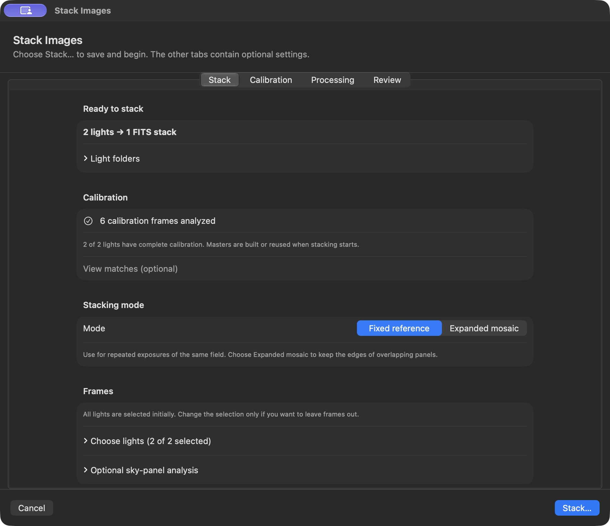
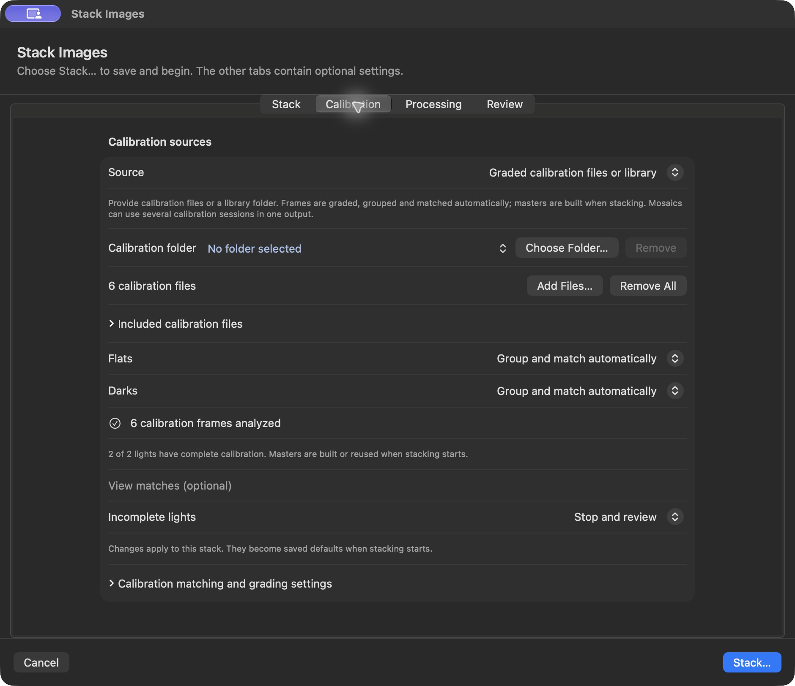
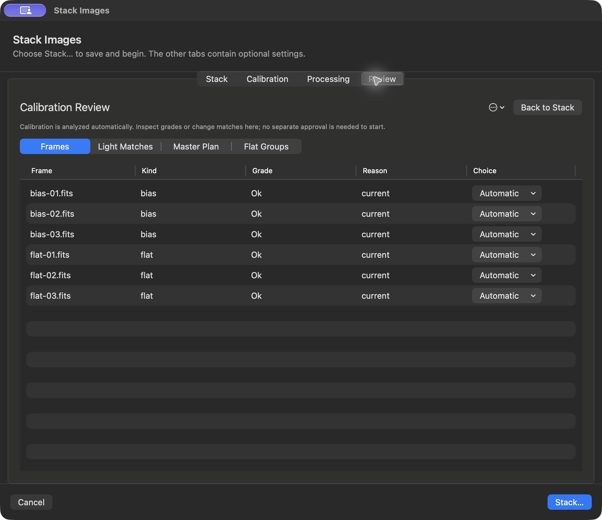
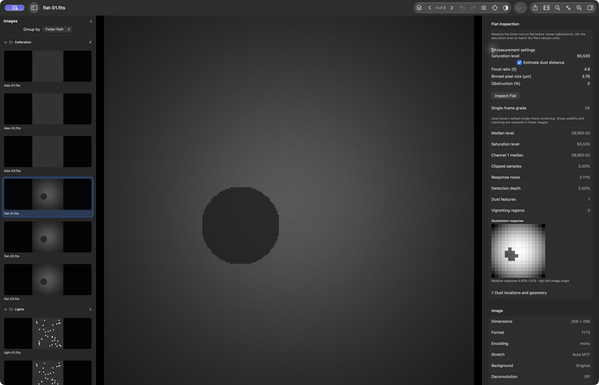

# Graded calibration in Stack Images

Stack Images calls `seiza_calibration_files_json`, the shared file coordinator
in [Seiza #406](https://github.com/theatrus/seiza/pull/406), based on Seiza/C ABI
**0.48.0**, calibration **0.11.0** and stacking **0.55.0**. Cargo pins exact
published crate versions from [Seiza 0.48](https://github.com/theatrus/seiza/releases/tag/v0.48.0),
with registry checksums in Cargo.lock. The generated C header matches the published package.
Swift owns setup, access grants and review; the app has no calibration
orchestrator in Rust. Both canvas modes support per-light sessions. Live
acquisition retains its existing preparation workflow.

## Start with defaults

1. Open a capture folder or a TXT/CSV image list and choose **File → Stack Images…**
   or the toolbar's stack icon. All detected lights are selected automatically.
2. Stay on **Stack** while calibration is analyzed and matched. The summary shows
   how many lights have complete calibration. No separate analysis, master-building
   or review approval is required.
3. Choose **Stack…** and an output destination. Seiza verifies the plan, builds or
   reuses masters, and applies each light's calibration in fixed or expanded stacks.

The folder can contain lights alongside bias, dark, dark-flat, flat frames and
masters, including in subfolders. Native FITS/XISF frame roles separate lights
from calibration automatically. Images without a recorded type are offered as
lights with an import note; unreadable and set-aside files have explanations.
The browser keeps all images available for inspection.

**Incomplete lights** defaults to **Stop and review**. If calibration is incomplete,
resolve the matches or explicitly choose **Exclude from stack** or **Keep with
available calibration** in Calibration. Exclusion requires at least two usable
lights in every output. Changing this policy does not restart analysis.

## Optional adjustments

- **Calibration**: add files or a separate library folder, change flat/dark
  association, and tune matching and grading globally or per rig. Per-rig controls
  appear after the first analysis. Camera and telescope metadata identify rigs;
  gain, offset and sensor fields still participate in native compatibility rules.
- **Review**: inspect frame grades and reasons, per-light matches, master recipes
  and measured flat groups. **Keep out**, **Use anyway** and **Clear choice** are
  bound to the exact source path and fingerprint. Editing choices or settings
  updates analysis automatically. Review is optional when calibration is complete.
- **Processing**: adjust alignment, reference and integration settings if needed.
  Each light's assignment also applies during transient-removal replay.

Discovery and measurement run off the main thread. Unchanged measurements are
reused under the current settings and grading peers; analysis itself does not
build masters. For source files changed outside the app, **Review → More (•••) → Refresh from Files** requests a fresh analysis. New execution
warnings, such as an unstable-flat retry, are shown before lights are processed.

Stack Images opens a resizable window with **Stack**, **Calibration**,
**Processing** and **Review** tabs. Stack is the starting page; the other tabs
are optional adjustments, not a sequence to complete. Review stays in that window, with an
unbordered segmented control for Frames, Light Matches, Master Plan and Flat
Groups. Matching settings live in Calibration. Browser thumbnails remain active
while setup is idle; only master preparation and stacking pause them. Light folders (under the Stack summary)
and the optional calibration folder have native path controls; **Choose Folder**,
**Remove**, **Add Files** and individual file removal keep the two sources
independent. Removing a source only removes it from this setup.

Settings and review choices are drafts until stacking starts. **Cancel**, closing
the window or cancelling the output picker leaves saved defaults unchanged.
Numeric controls stay editable while analysis is delayed or running; changing a
matching setting cancels the old request and queues the latest values.

## Screenshots

These app captures use a synthetic night with two lights, three bias frames and
three flats. The flat contains a dust shadow for inspection.

Poor raw calibration frames stay out unless explicitly allowed. Suspect frames
remain eligible and retain their reasons in review. Existing masters are adopted
under Seiza's external-master setting, rather than graded as individual raws.
Ungraded selected inputs are reported as incomplete; they are not labelled OK.
Allowing a poor/ungraded frame never bypasses sensor or optical compatibility.
Unreadable selected lights and master-build failures stop preparation with an
error; Keep/Exclude does not hide those execution failures.

## Settings and shared decisions

The app renders the shared schema's matching, dark-selection, flat-group and grade controls,
including their defaults, native units and help. It persists global settings,
per-rig overrides, quality choices, incomplete-light policy, flat star masking and
flat-stability retry options. A rig can inherit each global value independently.
Unknown keys and invalid values are rejected by Seiza before image processing.
No grading thresholds, temporal selection rules or master-selection policy are
implemented in Swift. The Mac has no duplicate calibration coordinator.

The upstream file coordinator measures dark/bias/dark-flat and flat pixels, then uses
native `RuleBook`, `QualityIndex` and `Library` objects. `QualityIndex::regrade`
judges measurements once, and the exact judgments feed both review and selection.
Seiza determines grading peers, grades, compatible candidates, coherent cohorts,
external-master adoption, effective gates, session identities and master recipes.
Identical recipes share cached masters across lights and output groups.
Session identity version 5 treats master inputs as a set: different nearest-first
candidate orders reuse one session and build, anchored by the first light.
Builder options key only the recipes they affect. Native session methods decide
flat use, and the retry carries that session's policy and held-back frames.

Flats and darks each have an independent **Group and match automatically** /
**Use all as one set** choice, defaulting to automatic. Automatic flats use
Seiza's raw-response preparation, bounded sample selection, pixel measurements
and requested pair comparisons to establish response groups and change windows.
The Flat Groups review section shows measured sessions, families and changes. Darks
use the existing shared sensor/exposure/temperature and temporal selection.
One-set mode includes every eligible compatible input of that kind across
nights, without the automatic 64-input cap. It retains grading/exclusions and
physical gates, refuses incompatible sets or mixed/multiple masters, and disables
alternate-flat-session retries. Stability can still trim drifting raw flats.

Response planes are cached independently of settings and pedestal estimates.
Updated settings regrade and regroup stored measurements. Pair comparison cache
keys include response source stamps, pedestal levels and metric versions.
Untimed raw flats are explicitly reported; they cannot establish temporal changes.
Unknown/inconclusive light placement is reported as incomplete calibration and
follows the selected Stop/Exclude/Keep policy.

The executor uses the native master builder with the recipe's exact dependencies,
defect suppression, masking and dark screening. Flat stability measurements feed
`FlatRetry::for_session` and its `next`/`trimmed`/`alternate` methods: trim,
alternate-session retry, retain-with-warning and
withhold decisions stay in Seiza. Retry candidates go through the complete
planner again so a different flat exposure selects its own dark-flat dependency.
For flat-only mono sessions, native pedestal fits feed
`Session::accept_pedestal`. An accepted constant is materialized as a bias master for the fixed C
opener. Inconclusive/CFA fits withhold the flat and reapply the incomplete-light
policy; the host never silently forces a flat without pedestal removal.

## Sessions and source safety

Output groups, grading peers and calibration sessions serve different purposes.
Folders, CSV rows and sky-panel labels do not define calibration sessions. Matching
never searches for one compromise set for an entire mosaic. It preserves the
existing light/reference order and changes calibration at the assigned light.

Expanded planning calls `seiza_live_stacker_open_fits_expanding_sessions`, so each
planning reference receives the same calibration as its original light during
integration. Fixed planning opens each reference candidate under its own gate and
masters, then replaces the complete gate/rotation/master set before every push.
A failed setter aborts the push. Native history retains per-frame calibration
for A→B→A replay, including transient removal.

Seiza's shared file coordinator owns recursive discovery, file identities, cached
measurements and atomic master publication. Swift supplies a native cancellation
handle and retains platform access grants. The additional cache is under the
library's existing `CalibrationMasters` directory in `graded-library/`; live-stack
cache maintenance does not prune it. Automatic eviction for this new cache is
not implemented. Raw inputs are never modified. Declared 0:1 XISF samples are
staged in physical 16-bit ADU once, with role/calibration metadata retained.
Original paths remain visible in review and protected from output overwrite.

A review identity includes ordered sources, choices, settings and algorithm/output
versions. Changed sources or settings refuse execution until another analysis.
Device/inode/size/mtime (including nanoseconds) identify files; this is a file
stamp, not a cryptographic hash of every pixel. Staged sources and masters have
independently checked stamps, so corrupted or removed cache files are regenerated
or refused. Sources and historical masters cannot be overwritten by an output.
Scoped library/input URL access is retained during analysis, execution and the
stack, including explicitly provided file grants and after the review sheet closes.
Linked calibration files are read by their canonical targets; directory symlinks
and links into the cache are not traversed. Duplicate physical inputs are detected.
Refused library files are remembered by their source stamp, avoiding repeat pixel
reads when a library also contains lights or processed images.

## Light evidence, corrections and manual choices

The upstream coordinator uses Seiza's `plan_flat_sessions`, `PedestalTable`,
`family_questions` and `change_question` directly. It reads only their bounded
samples, then calls `FamilyQuestion::decide`, `ChangeFilter::change_map`/`fit`
and `ChangeQuestion::row`. Resolved evidence feeds `Library::select_associated`
and `resolve_session` before master recipes are chosen. Rust does not call the
C ABI's `library::json` workflows or convert native inputs through JSON.
The C ABI presents the resulting records to Swift in camelCase. Legacy preference
rows are converted at the boundary; enum values and settings keys retain their
native spellings. Change evidence excludes broad vignetting as directed
by the core; an inconclusive fit stays unknown and follows the incomplete-light
policy. Responses, light bins and evidence have separate stamped caches.

When the shared planner requires a correction, the executor loads its exact
before/after response dependencies, computes the full native change map, and
applies it to the effective flat after stability retries and pedestal handling.
Only the atomically published corrected master reaches the fixed or expanded
stacker, including transient-removal replay. A required correction that cannot
be produced aborts preparation. Corrected masters retain their acquisition and
calibration metadata and have separate cache identities.

In **Flat Groups**, split an edge, join it to the previous group, or restore
measured grouping. In **Light Matches**, choose a measured group or put a light
before/after an applicable change. Seiza resolves these commands and reports
applied/orphaned choices. Preferences retain them across runs; personal choices
are bound to the exact source path and fingerprint, so an identical basename
in another directory cannot inherit a choice. Changes invalidate the review.

Catalog-specific night/display controls, per-frame validity editing and light
check/report settings are not exposed in this setup. Live acquisition migration
and cache eviction/management remain follow-ups.

## Validation

[CalibrationParityTests](../Tests/CalibrationParityTests.swift) covers captured
PSF Guard screening, native session/checkpoint/replay, and the actual desktop
planner/executor/engine. The desktop tests exercise graded A→B→A assignments on
both canvases, corrected flat publication and transient-removal replay, manual
choice preference migration/round trips, per-rig gates overriding global defaults,
master reuse, Keep/Exclude/Stop changes against the same reviewed key, linked
calibration files, and protected/stale sources.

The [upstream coordinator tests](https://github.com/theatrus/seiza/blob/350a5e79700e6997047adecd35c0939cbf9a4234/seiza-stacking/src/calibration_files/mod.rs)
were moved with the implementation. They cover family/change evidence, unknown
fits, path-scoped choices, split/join, correction pixels/cache reuse, poor grades,
stability trim/rebuild, pedestal acceptance, normalized XISF staging, aliases,
settings/source review invalidation and cancellation. C and Python exercise the
same native coordinator; the [guide](https://github.com/theatrus/seiza/blob/350a5e79700e6997047adecd35c0939cbf9a4234/docs/calibration-files.md)
describes its Rust/C/Python interfaces and cache/source contracts.
